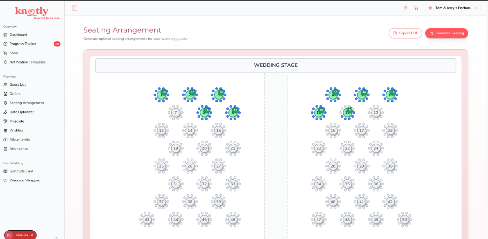
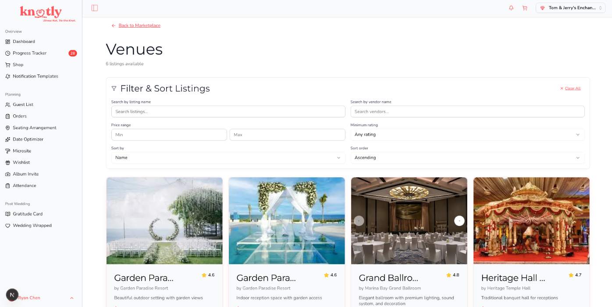
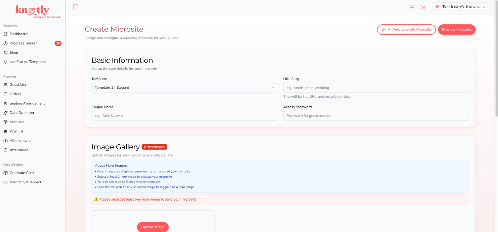
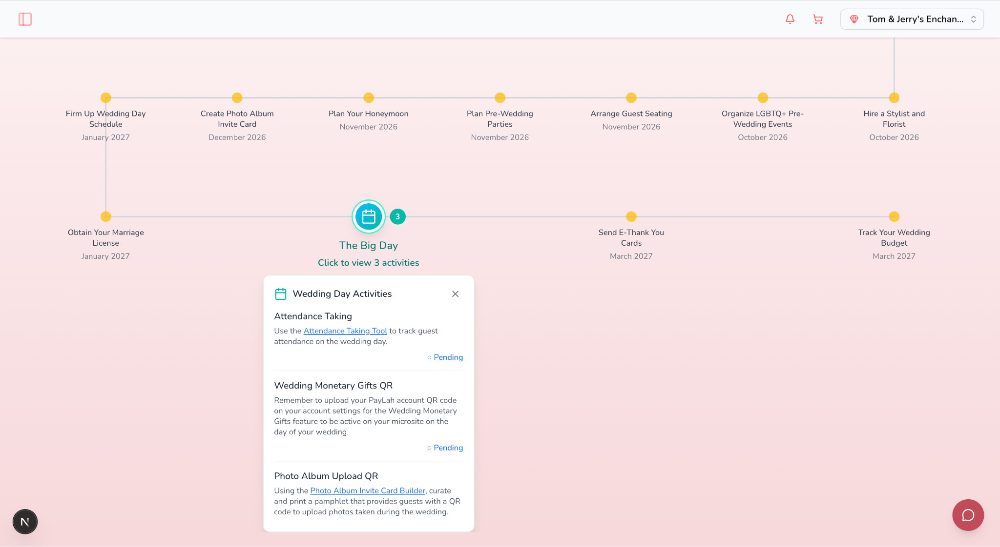
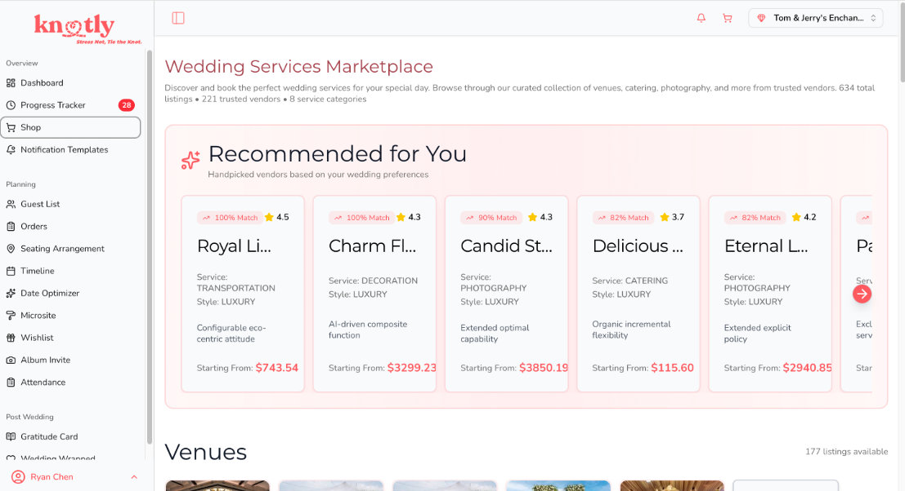
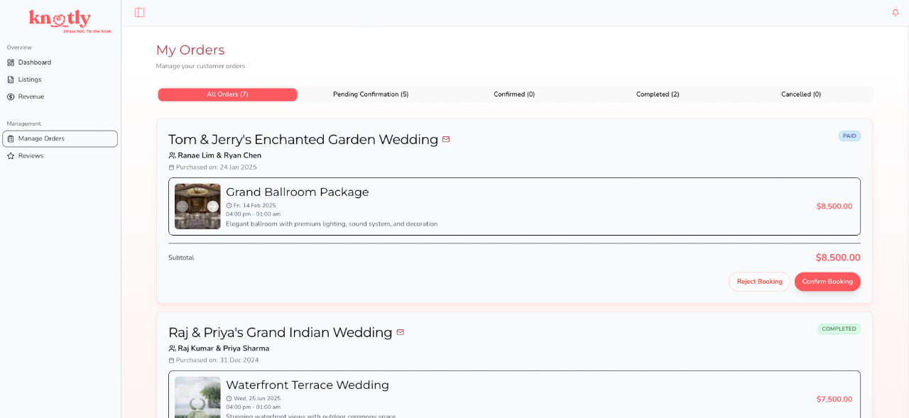
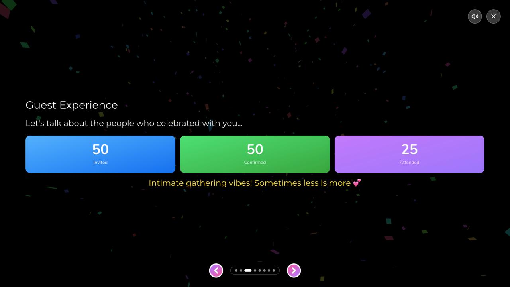

# Knotly · Wedding Management Frontend

Knotly brings wedding planning, vendor bookings, and the guest experience into one platform. Built as an NUS IS4108 AI Solutioning Capstone project, it supports couples, collaborators, vendors, guests, and platform administrators.

This monorepo contains the customer-facing application and the internal administration portal. Pair it with the [NestJS backend](https://github.com/glennquah/wedding-management-backend).

## Features

| Portal | What you can do |
| --- | --- |
| Couples and collaborators | Manage weddings, guest groups, dietary preferences, RSVPs, QR attendance, seating plans, budgets, orders, and gift wishlists. |
| Planning tools | Track tasks on a wedding timeline, generate checklists, chat with a wedding assistant, and request date optimization and vendor recommendations. |
| Wedding microsites | Customize event information, schedules, FAQs, galleries, and guest access; preview before publishing and generate content with AI. |
| Guests | RSVP, find seating information, send digital cash gifts, reserve wishlist gifts, upload photos, and leave guestbook messages. |
| Vendors | Register and complete onboarding, manage listings and bookings, connect Stripe, review revenue and payouts, and view customer reviews. |
| Platform administrators | Approve or suspend accounts, manage weddings and listings, send email notifications, and monitor bookings, revenue, growth, and payouts. |
| After the wedding | Create gratitude cards, curate photo albums, generate slideshows, and revisit highlights through Wedding Wrapped. |

AI features depend on the backend, OpenAI, and/or a separately hosted AI microservice; the models and that service are not bundled here.

## Screenshots

Screenshots from the project report illustrate the original capstone application.

### Seating arrangement



### Vendor marketplace



### Wedding microsite


### Microsite builder



### Planning timeline



### Vendor recommendations



### Vendor bookings



### Wedding Wrapped



## Stack and structure

Next.js 16, React 19, TypeScript, Tailwind CSS, Radix UI, Zustand, NextAuth, and Turborepo. The API client is generated from the backend's OpenAPI schema. AWS deployment uses SST 4 and OpenNext. Development and builds explicitly use Webpack to preserve the existing alias configuration. Both apps pin the same React and React DOM version to avoid workspace runtime mismatches.

```text
apps/external/       Couples, vendors, guests, and public microsites (port 3000)
apps/internal/       Platform administration (port 3001)
shared/api/          Generated API client and models
shared/components/  Shared UI components
scripts/            API generation helpers
sst.config.ts       AWS deployment configuration
```

## Local setup

Use Node.js 22.22.3 or newer and npm 10 or newer. Install dependencies from the repository root:

```bash
npm ci
cp apps/external/.env.example apps/external/.env.local
cp apps/internal/.env.example apps/internal/.env.local
```

Fill in both local environment files. Generate a random `NEXTAUTH_SECRET` for each app with `openssl rand -base64 32`. Keep secrets server-side; every `NEXT_PUBLIC_*` value is exposed to the browser. Cloudinary uploads require your own cloud name and upload preset. The external chat route requires your own OpenAI API key.

Start the backend on port 8080 using its setup instructions, then start both portals:

```bash
npm run dev
```

- Customer portal: http://localhost:3000
- Internal portal: http://localhost:3001

Accounts, weddings, and listings come from your backend database. There is no standalone mock mode. Backend seed accounts are for isolated local development only.

## Development

| Command | Purpose |
| --- | --- |
| `npm run dev` | Start both apps |
| `npm run build` | Build all workspaces |
| `npm run build:external` | Build the customer portal |
| `npm run build:internal` | Build the internal portal |
| `npm run lint` | Lint both apps |
| `npm run test:auth` | Check production portal guards after building |
| `npm run generate-api-types` | Regenerate `shared/api` from http://localhost:8080/api-json |

Run API generation with the backend running, then inspect the generated diff. Import shared components from `shared/components` using the aliases configured in each app.

Run `npm run lint` to check both apps with ESLint. Existing React Compiler diagnostics are warnings while the app remains uncompiled; hooks correctness rules retain their existing severity. Run `npm run build` followed by `npm run test:auth` to check anonymous/wrong-role redirects and valid-role access in both production portals, plus public login/auth endpoints. There are no app workspace test scripts; the root Turbo test command does not run these smoke checks.

## Deployment

`sst.config.ts` describes two AWS Next.js deployments. It currently targets the original project's domains and Route 53 hosted zone; replace these with infrastructure you own before deploying. Configure secrets through your deployment environment and review `.github/workflows` before enabling automated deployments. `NEXTAUTH_SECRET` is required and has no deployment fallback.

The toolchain now uses SST 4. Existing SST 3 deployments require a reviewed state migration before deployment: follow the [SST migration guide](https://sst.dev/docs/migrate-from-v3/), review `sst diff`, then run a full `sst refresh --stage production` against your own account. This state migration has not been performed by this PR.

`npm run deploy` targets the production stage and creates or updates AWS resources. Local development does not require AWS access.

## Contributing and security

Include a clear description and verification steps with contributions. Keep generated API changes separate where practical. Never include real customer data, credentials, or local environment files in an issue or pull request. See [SECURITY.md](SECURITY.md) for reporting and release precautions.

## License and assets

A project license has not been selected. Public source availability alone does not grant an open-source license. The maintainers must choose a license and confirm contributor rights before release. Screenshots, photos, fonts, and externally hosted audio may have separate rights; review those assets before redistributing them.

## Dependency maintenance

The npm overrides select patched Undici, multipart-parser, and glob-matcher releases while upstream packages catch up. Revisit them when updating the parent packages. CI fails on high or critical dependency advisories, and Dependabot checks for updates weekly.

## Release review

See [the open-source preparation review](docs/OPEN_SOURCE_REVIEW.md) for credential-scan findings, dependency advisories, validation, and remaining release decisions.
